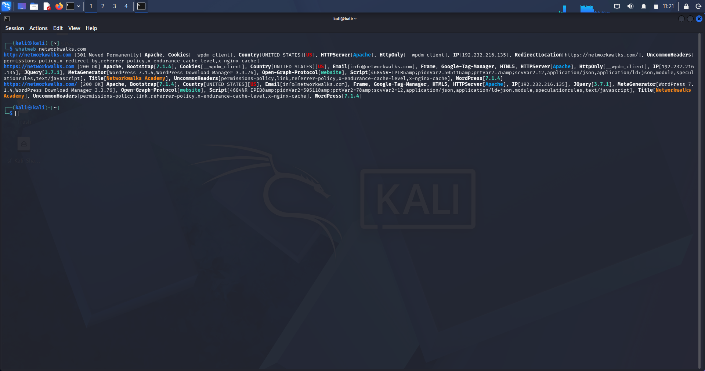
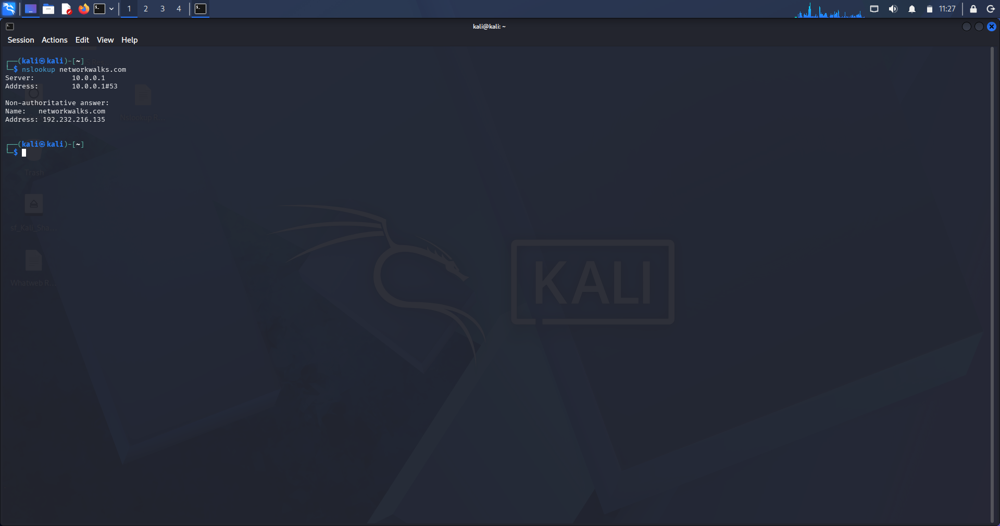
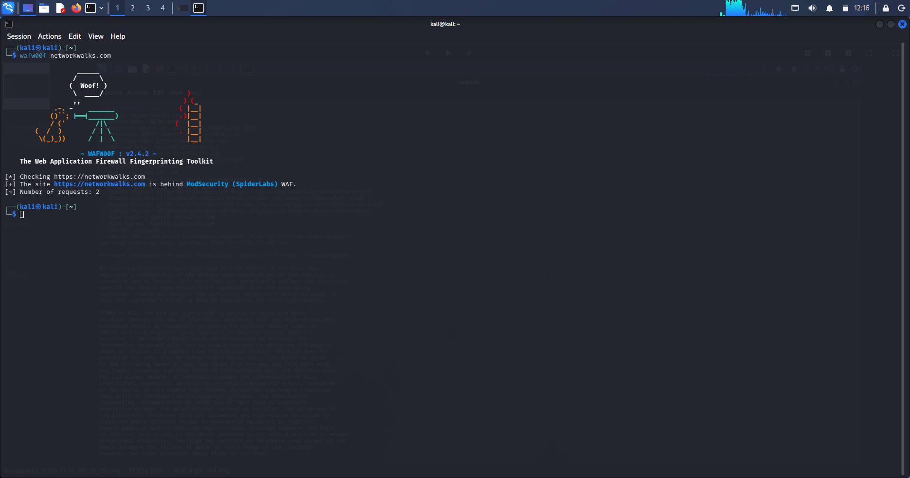

# PENETRATION TESTING REPORT
## FOOTPRINTING & NETWORK SCANNING PHASES

**W2-PM1 | W2-PM5 | CYBERSECURITY | NETWORKWALKS**

---

## Report Information

| **Field** | **Details** |
|---|---|
| **Pentester Name (Cybersecurity Professional)** | Kwabena Ansah-Amtwi |
| **Program/Batch** | B084-Networkwalks |
| **Date** | 13 November 2026 |
| **Modules Completed** | W2-PM1 (Footprinting with Multiple Kali Tools) |
| | W2-PM5 (Zenmap Network Scanning) |
| **Client/Target** | 1. Networkwalks: networkwalks.com (target assigned by the course) |
| | 2. My own local LAN network |
| **Permission Secured from Client?** | Yes |
| **Phases Covered** | **Phase 1:** Reconnaissance & Footprinting |
| | **Phase 2:** Scanning & Network Discovery |
| | **Phase 3–5:** In Progress |

---

# 1. Liability Disclaimer

I have performed these activities only on the systems and devices where I had permission or that I own myself. All these materials are for educational and research purposes only. Do not use anything from here to break the law.

The instructor, the authors and Networkwalks are not responsible for what you do with this knowledge. Every action you take is your own responsibility. Misuse can lead to criminal charges, heavy fines, loss of your job and a permanent record. In most countries, unauthorised access is a crime even when nothing is damaged.

# 2. Introduction

This report covers two Week 2 modules of my Cybersecurity & Ethical Hacking course at Networkwalks.

W2-PM1 involved footprinting the networkwalks.com domain using six built-in Kali Linux tools. W2-PM5 involved scanning my own local network with Zenmap to discover live hosts.

Together, these modules demonstrate how an attacker moves from gathering public information about a domain to mapping live hosts on a network.

Every step below includes the tool or action used, the result observed, a screenshot as evidence, and a short note on why the finding matters from a security perspective.

# 3. Tools Used

The table below lists each tool used in this report and its purpose.

| **Tool** | **Purpose** |
|---|---|
| Kali Linux & Windows | Operating systems used for the reconnaissance and scanning activities. |
| whois | Find domain registration details (registrar, dates, name servers). |
| whatweb | Fingerprint web technologies (server, CMS, plugins, IP). |
| nslookup | Resolve the domain name to its IP address using DNS. |
| curl -I | Read the HTTP response headers of the website. |
| wafw00f | Detect whether a Web Application Firewall (WAF) protects the site. |
| dnsrecon | Enumerate DNS records (NS, MX, SPF, TXT, SRV). |
| Zenmap (Nmap GUI) | Scan the local subnet to find live hosts, IPs and MAC addresses, and draw a topology map. |
| Windows CMD (ipconfig) | Find my PC's local IP address, subnet mask and MAC address. |

# 4. Activities Performed

## 4.1 Footprinting & Reconnaissance with Kali Tools (W2-PM1)

Footprinting means collecting public information about a target before conducting further security assessments.

I ran six Kali Linux tools against networkwalks.com, each revealing a different piece of information about the target.

| **Tool / Command** | **What I Found** | **Why It Matters to an Attacker** |
|---|---|---|
| **Task 1: whois networkwalks.com** | Registrar: GoDaddy.com, LLC. Created: 6 November 2019. Expires: 6 November 2027. Name servers: NS6135.HOSTGATOR.COM and NS6136.HOSTGATOR.COM. DNSSEC: unsigned. | Shows domain registration details and hosting-related information. Registration dates and publicly available contact information may assist social engineering. |
| **Task 2: whatweb networkwalks.com** | The site redirects HTTP to HTTPS. Apache web server, WordPress 7.1.4, WP Download Manager 3.3.58, jQuery 3.7.1. IP address: 192.232.216.135. Contact email: info@networkwalks.com. | Exact software versions can be researched against known vulnerability databases. The results also reveal the server IP and a contact email address. |
| **Task 3: nslookup networkwalks.com** | Resolved through DNS server 8.8.8.8 to 192.232.216.135. | Knowing the domain's resolved IP address provides information about the web infrastructure. |
| **Task 4: curl -I https://networkwalks.com** | HTTP/2 200 response. Server header: Apache. x-nginx-cache: WordPress. A session cookie (__wpdm_client) marked Secure and HttpOnly. A Link header exposing the WordPress REST API at /wp-json/. | Headers reveal server information, caching configuration and publicly advertised endpoints without loading the entire webpage. |
| **Task 5: wafw00f networkwalks.com** | The site is behind ModSecurity (SpiderLabs) WAF. Number of requests: 2. | Identifies the presence and type of web application protection, providing information about the site's security architecture. |
| **Task 6: dnsrecon -d networkwalks.com** | 8 records found: SOA and NS (ns6135 / ns6136.hostgator.com), BIND DNS version 9.16.23, MX mail.networkwalks.com (192.232.216.135), A record, SPF record, a Google verification TXT record, and cPanel _autodiscover SRV records. | Maps DNS infrastructure information, including mail servers, DNS software details and hosting configuration. |

### Key Terms in Plain Language

- **WAF (Web Application Firewall):** A filter in front of a website that blocks suspicious web requests.
- **DNS:** The internet's phone book, which turns names like networkwalks.com into IP addresses.
- **NS / MX records:** NS identifies the servers responsible for answering DNS questions for a domain; MX identifies the servers that receive its email.
- **SPF:** A DNS text record that lists which servers are allowed to send email for a domain, helping prevent email spoofing.
- **SRV records:** DNS records that point to specific services (here, cPanel email auto-discovery).
- **Fingerprinting:** Working out what software a system runs from the information it reveals.

---

## 4.2 Network Scanning with Zenmap (W2-PM5)

Zenmap is the official graphical interface for Nmap, a free and open-source security scanner.

I completed the seven tasks of the practical on my own network as follows.

| **Task** | **What Was Required** | **What I Did / Result** |
|---|---|---|
| **Task 1** | Download and install Zenmap. | Downloaded the Nmap installer from https://nmap.org/download.html and installed it with all default components (including Zenmap and Npcap). Version: Nmap 7.93. |
| **Task 2** | Find my local IP address and LAN subnet. | Ran `ipconfig` in Windows CMD. IPv4 address: `192.168.100.14`. Subnet mask: `/24`. LAN subnet: `192.168.100.14/24`. |
| **Task 3** | Find live hosts in the subnet. | Entered my subnet in the Zenmap Target box, selected the **Ping scan** profile (`nmap -sn` followed by `/24`) and clicked Scan. |
| **Task 4** | How many hosts are live? | 13 hosts are live (including my own PC). |
| **Task 5** | IP addresses of the live hosts. | Discovered 13 IP addresses, listed in the table below. |
| **Task 6** | MAC addresses of the live hosts. | Collected the MAC addresses of the discovered hosts, listed in the table below. |
| **Task 7** | Save the topology as PDF. | Opened the **Topology** tab, turned on the legend, and used **Save Graphic** to save the topology as a PDF on my desktop. File name: `nmap_topology_192_168_100.pdf`. |

### Live Hosts Discovered

| **#** | **IP Address** | **MAC Address** | **Notes (Device Type / Vendor)** |
|---|---|---|---|
| 1 | 192.168.100.1 | D8:59:82:4E:17:14 | Router / Gateway (Huawei Technologies) |
| 2 | 192.168.100.6 | 7E:78:1B:63:52:FF | Unknown device |
| 3 | 192.168.100.10 | FC:03:9F:D2:E4:C9 | Samsung device (Samsung Electronics) |
| 4 | 192.168.100.14 | BC-03-58-49-DA-13 | My PC (Scanning host) |
| 5 | 192.168.100.22 | E0:D0:45:57:89:BF | Intel device / PC (Intel Corporate) |
| 6 | 192.168.100.55 | A8:96:09:1C:CE:41 | FN-Link device (FN-Link Technology) |
| 7 | 192.168.100.129 | EE:86:D3:34:C9:0C | Unknown device |
| 8 | 192.168.100.131 | 6E:EA:C8:D8:79:E2 | Unknown device |
| 9 | 192.168.100.148 | F8:4E:58:00:04:50 | Samsung device (Samsung Electronics) |
| 10 | 192.168.100.175 | 40:80:E1:D5:CF:3C | FN-Link device (FN-Link Technology) |
| 11 | 192.168.100.206 | E2:BD:00:47:82:CC | Unknown device |
| 12 | 192.168.100.214 | A8:96:09:1C:CE:41 | FN-Link device (FN-Link Technology) |
| 13 | 192.168.100.216 | 40:80:E1:D5:CF:3C | FN-Link device (FN-Link Technology) |

### Reading the Topology

Each dot in the topology represents a host, and the legend explains the colours (for example, green means a host with fewer than 3 open ports, which is expected for a ping scan that does not scan ports).

My topology displays 13 green host nodes connected radially around the central network node on the `192.168.100.0/24` subnet.

**Note:** A ping scan (`-sn`) only finds which hosts are up. It does not scan ports or services, so no vulnerabilities were tested.

---

# 5. Risk Analysis / Impact

Based on the information collected during the footprinting and network scanning activities, I identified the following potential risks.

| **#** | **Risk / Finding** | **Evidence / Observation** | **Potential Impact** | **Risk Level** |
|---|---|---|---|---|
| 1 | Web technology information exposed | WhatWeb identified WordPress 7.1.4 and WP Download Manager 3.3.58. | Attackers may use exposed version information to research known weaknesses that require further review. | **Medium** |
| 2 | Server IP address identifiable | Nslookup resolved the domain to 192.232.216.135. | Provides information about the network location of the web service. | **Low** |
| 3 | HTTP technical information exposed | Curl returned headers showing Apache and the /wp-json/ REST API endpoint. | May assist technology fingerprinting and further enumeration. | **Low** |
| 4 | WAF technology identifiable | Wafw00f identified ModSecurity (SpiderLabs). | Reveals information about the web application's security architecture. | **Low** |
| 5 | DNS infrastructure information exposed | DNSRecon returned NS, MX, SPF and SRV records, along with BIND version 9.16.23. | DNS information helps build a broader infrastructure profile. | **Medium** |
| 6 | Contact email address exposed | WhatWeb identified info@networkwalks.com. | Could be used for phishing or social engineering. | **Medium** |
| 7 | Multiple live hosts visible on local network | Zenmap Ping scan found 13 live hosts. | Unknown or unauthorised devices may be present on the network. | **Medium** |

**Risk Level Key:** Critical | Medium | Low

The risks above are observations from the footprinting and scanning exercises, not confirmed vulnerabilities.

The practical exercises primarily involved information gathering, OSINT and host discovery. No exploitation or vulnerability validation was performed as part of these modules.

Therefore, the presence of information such as a software version, IP address, DNS record or publicly indexed device does not by itself mean that the system is vulnerable or compromised. Further authorised security testing would be required to confirm any actual vulnerability.

# 6. Recommendations

Based on the observations from these activities, I recommend the following security improvements:

1. **Review publicly exposed technology information:** Regularly review what web technologies, CMS and plugin versions are publicly visible.
2. **Keep software updated:** Update the CMS, plugins and other web technologies, and check them against current security advisories.
3. **Review HTTP headers:** Remove or reduce unnecessary technical information in HTTP response headers and consider restricting the REST API where it is not needed.
4. **Review DNS records regularly:** Check DNS records periodically so that only required information and services are public, and keep DNS software updated.
5. **Configure and monitor the WAF:** Keep the WAF (ModSecurity) enabled and properly configured.
6. **Reduce public email exposure:** Avoid publishing direct contact emails where possible, or use monitored aliases to reduce phishing risks.
7. **Perform regular internal network discovery:** Scan your own network periodically to identify active devices.
8. **Investigate unknown devices:** Any unexpected device found during scanning should be identified and verified, or removed.
9. **Maintain network documentation:** Keep the network topology and device list documented and up to date.
10. **Perform security testing with authorisation:** Reconnaissance and scanning should only be performed on systems where permission has been given or that you own.

# 7. Conclusion

During Week 2 of my Cybersecurity & Ethical Hacking course, I completed practical activities covering footprinting with command-line tools and network scanning.

In the Kali tools activity, I learned how whois shows domain registration details, whatweb identifies web technologies, nslookup resolves domain names, curl -I shows HTTP headers, wafw00f identifies a WAF, and dnsrecon lists DNS records.

In the network scanning activity, I used Zenmap to identify my local network configuration, discover active hosts, collect IP and MAC address information, and save a network topology.

Across both modules, the common lesson was that reconnaissance and scanning can reveal valuable information about a target before any exploitation takes place. I also learned that a good report explains what was done, what was found, what it means, what risk it may create, and how to reduce that risk.

Finally, reconnaissance and scanning must always stay within an authorised scope. These activities were completed as part of the assigned educational cybersecurity course.

# 8. Evidence Collected

The following screenshots provide evidence of the activities completed during the two modules.

## W2-PM1: Footprinting with Kali Tools

### Figure 1: WHOIS

### Figure 2: WhatWeb

### Figure 3: NSLookup

### Figure 4: CURL -I

### Figure 5: WAFW00F

### Figure 6: DNSRecon

---

## W2-PM5: Zenmap Network Scanning

### Figure 7: Zenmap Installed

### Figure 8: Local IP and Subnet

### Figure 9: Ping Scan Results

### Figure 10: Network Topology

---

# 9. Full Report

The complete penetration testing report, including detailed explanations, findings, risk analysis, recommendations and supporting documentation, can be accessed below.

📄 **[View Full Penetration Testing Report](Report/Kwabena_Ansah-Amtwi_W2-PM1_W2-PM5_Report_B084.pdf)**
---

**Training Program:** Networkwalks Cybersecurity & Ethical Hacking

**Batch:** B084

**Modules:** W2-PM1 | W2-PM5

**Report Author:** Kwabena Ansah-Amtwi

**Date:** 13 November 2026

